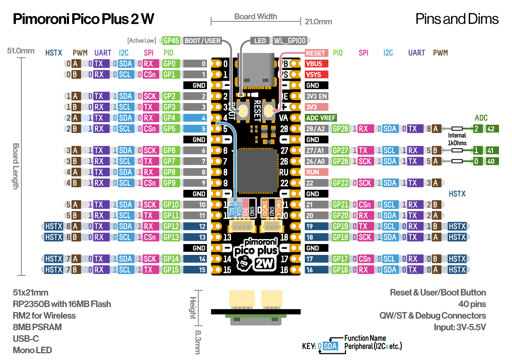
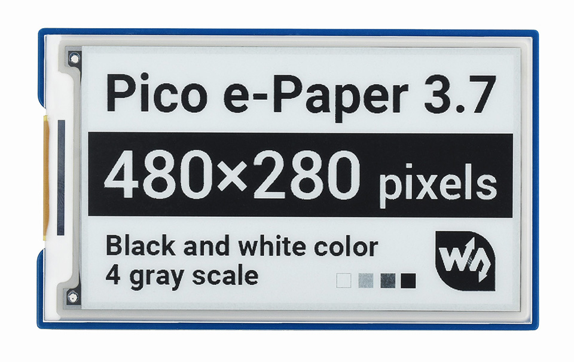
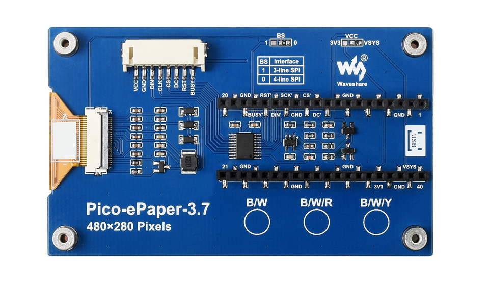
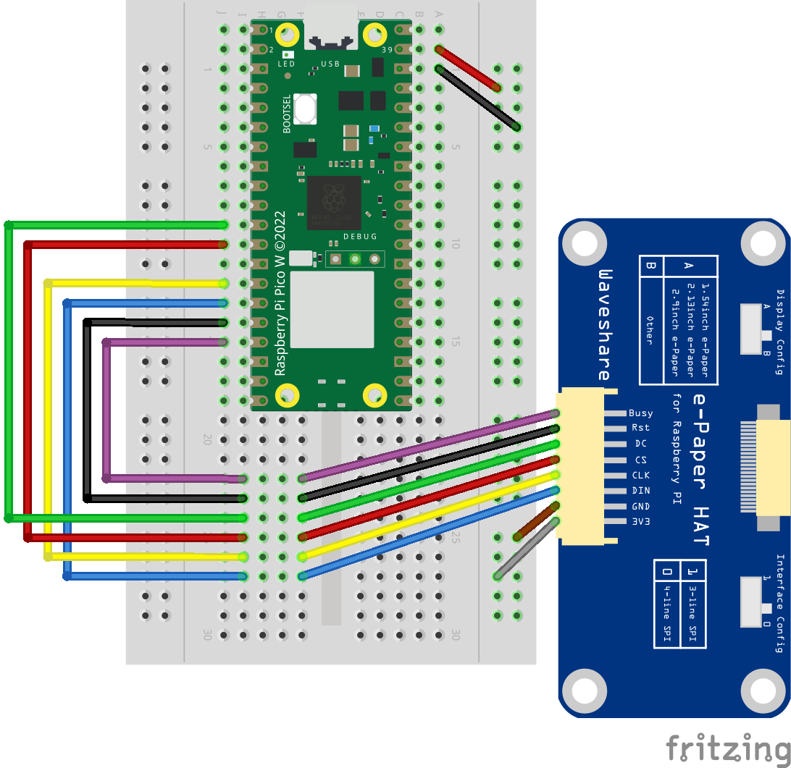
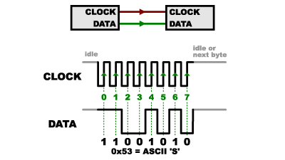
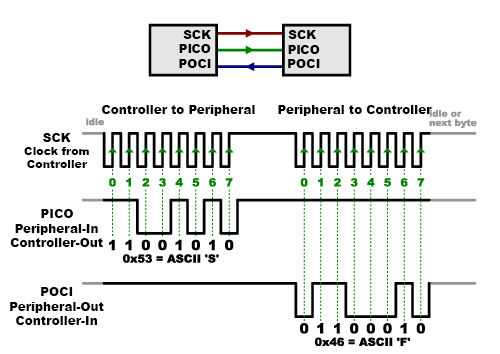
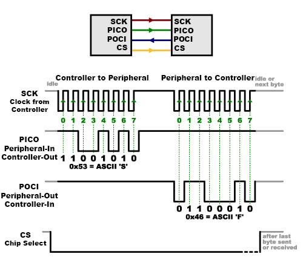
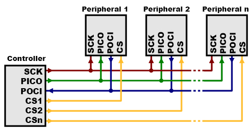

# London Pi Tube

A simple project using **Pimoroni Pico Plus 2W** combined with a **Waveshare Pico-ePaper 3.7" E-ink Display** to build a TFL dashboard displaying office-bound tube departure schedules.

## Table of contents

- [Hardware Component Overview](#hardware-component-overview)
  - [Pimoroni Pico Plus 2W](#pimoroni-pico-plus-2w)
    - [Key Processing & Core Architectural Features:](#key-processing--core-architectural-features)
    - [Wireless Interface Features:](#wireless-interface-features)
  - [Waveshare Pico-ePaper 3.7" E-ink Display](#waveshare-pico-epaper-37-e-ink-display)
    - [Display Performance Characteristics:](#display-performance-characteristics)
- [System Integration & Wiring Schedule](#system-integration--wiring-schedule)
- [Debugging & Diagnostics Infrastructure: SWD, UART, and the "Dumpster Fire" Handler](#debugging--diagnostics-infrastructure-swd-uart-and-the-dumpster-fire-handler)
  - [1. Serial Wire Debug (SWD)](#1-serial-wire-debug-swd)
  - [2. Universal Asynchronous Receiver-Transmitter (UART)](#2-universal-asynchronous-receiver-transmitter-uart)
  - [3. The Custom "E-ink Screen of Death" Panic Handler](#3-the-custom-e-ink-screen-of-death-panic-handler)
- [SPI Bus Communication Topology](#spi-bus-communication-topology)
  - [Synchronous Frame Transmission](#synchronous-frame-transmission)
  - [Chip Select Addressing & Multiple Peripherals](#chip-select-addressing--multiple-peripherals)
- [Compiling & Flashing to the Chip](#compiling--flashing-to-the-chip)
  - [Prerequisites](#prerequisites)
  - [Installation & Flashing via probe-rs](#installation--flashing-via-probe-rs)
  - [Manual Flashing via UF2 Mass Storage Mode](#manual-flashing-via-uf2-mass-storage-mode)
- [Too Poor to Afford a 3D printer?](#too-poor-to-afford-a-3d-printer)
- [Gallery](#gallery)

## Hardware Component Overview

### Pimoroni Pico Plus 2W
The [Pimoroni Pico Plus 2W](https://shop.pimoroni.com/products/pimoroni-pico-plus-2-w?variant=42182811942995) is a low-cost, ultra-high-performance microcontroller board built around Raspberry Pi's upgraded **RP2350** silicon architecture. It retains the familiar Pico W form-factor but introduces sweeping performance improvements, specifically optimized for data-dense processing and embedded networking applications.


*Figure 1: Pimoroni Pico Plus 2W Pinout.*

#### Key Processing & Core Architectural Features:
* **RP2350 Microcontroller Chip:** Designed by Raspberry Pi in the United Kingdom.
* **Dual-Core ARM Cortex-M33 Processor:** Running at an accelerated, flexible clock speed up to **150 MHz**.
* **Massively Upgraded Memory Profile:** Features **520KB of internal SRAM**, packed alongside an expanded **8MB of on-board flash memory**, and an additional **8MB of external PSRAM (Pseudo-Static RAM)** mapped directly into the data bus space.
* **Secure Boot and Security Hardware:** Features hardware SHA-256 accelerators, a true random number generator (TRNG), and secure OTP boot slots.
* **Peripherals:** 2× SPI, 2× I2C, 2× UART, 3× 12-bit ADC, up to 24× controllable PWM channels.
* **Dual Programmable I/O Blocks:** 12× Programmable I/O (PIO) state machines across 3 separate blocks for advanced high-speed custom peripheral emulation.

#### Wireless Interface Features:
The board mounts an integrated **Infineon CYW43439** wireless module providing robust internet connectivity:
* **Wi-Fi Connectivity:** Single-band (2.4 GHz) 802.11n support.
* **Security Support:** Secure WPA3 implementation.
* **Soft Access Point (AP):** Supports hosting networks for up to four client nodes.
* **Bluetooth 5.2 Ecosystem:** Full support for Bluetooth Low Energy (BLE) Central/Peripheral configurations alongside Bluetooth Classic connections.


### Waveshare Pico-ePaper 3.7" E-ink Display
A paper-like, monochrome electrophoretic matrix display ideal for low-power dashboards that remain static over long observation windows.


*Figure 2: Waveshare Pico-ePaper 3.7" E-ink Display (front)*


*Figure 3: Waveshare Pico-ePaper 3.7" E-ink Display (back)*

| Pin Name | Pin Description |
| :--- | :--- |
| **VCC** | 3.3V / 5V Main System Power Supply input |
| **GND** | System Ground Reference |
| **DIN** | Synchronous SPI Serial Data Input line (MOSI/POCI) |
| **CLK** | Synchronous SPI Serial Clock Timing input line (SCK) |
| **SS / CS** | SPI Peripheral Chip Select (Asserted Low active) |
| **DC** | Data / Command hardware mode selection pin (High = Data, Low = Command) |
| **RST** | External Hardware System Reset pin (Asserted Low active) |
| **BUSY** | Display Controller Busy Status Indicator output pin |

*Table 1: Waveshare Pico-ePaper 3.7" E-ink Display Pin Descriptions.*

#### Display Performance Characteristics:
* **Resolution Canvas:** 3.7" Diagonal space displaying an absolute resolution layout of **480x280 pixels**.
* **Viewing Envelope:** Ultra-wide viewing angle exceeding 170°.
* **Color Spectrum:** Black and White native output rendering with **four levels of grey grayscale depth**.
* **Bistable Memory Retentivity:** No active backlight; display elements retain content permanently without drawing power even when system power is severed entirely.
* **Low Current Draw:** Consumes current near zero, drawing micro-amps strictly during active frame redraw refreshes.


## System Integration & Wiring Schedule

The Pimoroni Pico Plus 2W hosts the display panel by mapping dedicated SPI peripheral controllers. Power is drawn safely from the board's main supply output rails (`VSYS`).

| Pimoroni Pico Plus 2W Pin | Waveshare Pico-ePaper 3.7" Display Pin |
| :--- | :--- |
| **VSYS** | VCC |
| **GND** | GND |
| **GP11 (SPI1 TX)** | DIN |
| **GP10 (SPI1 SCK)** | CLK |
| **GP09 (SPI1 CS)** | CS |
| **GP08 (Output)** | DC |
| **GP12 (Output)** | RST |
| **GP13 (Input)** | BUSY |

*Table 2: Wiring Interconnection Reference Schedule.*


*Figure 4: Breadboard Schematic Layout of Pimoroni Pico Plus 2W and Waveshare E-ink Display.*

## Debugging & Diagnostics Infrastructure: SWD, UART, and the "Dumpster Fire" Handler

For institutional embedded applications, relying purely on LED blinks is insufficient. The architecture uses independent infrastructure interfaces for system diagnostics, low-level execution tracing, and inline bare-metal debugging.

### 1. Serial Wire Debug (SWD)
SWD is a two-wire bi-directional protocol designed by ARM specifically for microcontrollers. Unlike full-scale multi-pin JTAG interfaces, SWD optimizes pin usage while retaining deep access to the inner silicon registers.

* **Physical Interconnect:** It uses two primary physical lines: **SWCLK** (Serial Wire Clock driven by the host hardware probe) and **SWDIO** (Serial Wire Data Input/Output bi-directional data line). 
* **Core Debug Capabilities:** Through the SWD port, an external hardware debugger tool (such as a Raspberry Pi Debug Probe) commands direct control over the RP2350 core execution states. This allows developers to set hardware breakpoints, step line-by-line through asynchronous Rust futures, and dump memory spaces or variables at runtime without modifying application execution code.
* **`probe-rs` Integration:** The modern Rust firmware development ecosystem utilizes `probe-rs` to link the compiler directly to the SWD core interface over USB. Running `cargo run` automatically flashes the payload across SWD and hooks directly into system panic traps.

### 2. Universal Asynchronous Receiver-Transmitter (UART)
While SWD modifies execution states and manages raw hardware memory registers, UART serves as the primary asynchronous communication link for application-layer logging output (`defmt` or standard text tracing).

* **Asynchronous Signalling:** Next to SPI or SWD, UART is completely asynchronous and does not require an independent clock line. Instead, both the transmitter (TX) and receiver (RX) operate using a pre-agreed speed setting called a **Baud Rate** (typically 115200 bps in this project).
* **Frame Alignment:** Frame data packets align cleanly on the bus using hardware-level **Start** and **Stop** framing bits inserted around each transmitted byte. 
* **Diagnostics Workflow:** The RP2350 redirects standard panic text outputs and structural trace statements (`info!()`, `warn!()`, `error!()`) down to internal UART controllers mapped out to explicit GPIO terminal pins. Connecting these lines to a USB-to-UART bridge allows real-time execution insights to be safely monitored inside a development terminal window.

### 3. The Custom "E-ink Screen of Death" Panic Handler
In Rust, when software hits an unrecoverable edge case (like stack corruption or a failed unwrap), the CPU "panics". On a typical headless microcontroller, this cleanly halts execution silently—leaving the user staring at a frozen display wondering if the internet dropped or if the board died.

To avoid this, this project overrides the standard `#[panic_handler]` behavior with a custom hardware rendering routine:
* **The Post-Mortem Canvas Force-Push:** When a panic occurs, the handler high-jacks the SPI bus, completely bypasses the standard async task scheduling system, and locks onto the display peripheral in a bare-metal fallback state.
* **Visualising Failure:** It actively draws the file name, line number, and error message across the E-ink display panel.
* **Permanent Humiliation:** Because E-ink displays are completely bi-stable and require zero power to sustain an image, **the exact error message and dumpster-fire layout remain frozen on screen indefinitely** even if you unplug the device. It serves as an un-ignorable, low-level hardware sticky note pointing out exactly which thread panicked.

## SPI Bus Communication Topology

### Synchronous Frame Transmission
SPI (Serial Peripheral Interface) operates as a high-speed, synchronous serial communications link tailored for short-distance board-level transfers. Data flows over full-duplex lines matching independent transmitter and receiver pathways.

 
*Figures 5 & 6: Synchronous SPI Serialization Architecture Overview.*

Synchronization is maintained explicitly by the controller using a dedicated clock signal line (**CLK**). This clock line oscillates to define explicit bit boundary transitions:
* **Sampling Transitions:** The receiving hardware samples state lines directly on the rising edge (low-to-high transition) or falling edge (high-to-low transition) of the clock signal.
* **Clock Independence:** Because timing synchronization travels alongside raw data bit positions, bus speeds can adapt dynamically across ranges governed strictly by the maximum hardware thresholds of the slowest slave device.


### Chip Select Addressing & Multiple Peripherals

To control multiple devices on a single SPI bus, independent Chip Select lines are routed from the controller to each peripheral on the bus.

 
*Figures 7 & 8: Peripheral Bus Addressing Topologies.*

* **The SPI Bus vs. Device Distinction:** The "SPI Bus" represents the shared physical copper trace channels (Clock, Data lines) tracking across the board. Multiple independent chips can share the same channel array to interface with the primary controller.
* **Coexistence with Wireless Hardware:** The on-board Infineon CYW43439 Wi-Fi chip communicates internally with the RP2350 via a dedicated SPI channel block. Since the RP2350 offers two completely independent hardware SPI blocks (`SPI0` and `SPI1`), network transactions can execute simultaneously alongside active display canvas updates.
* **Bus Arbitration:** Devices sharing an active bus array isolate their interfaces by monitoring their unique **CS (Chip Select)** pin. The controller pulls this pin low to wake a specific target device for data transfer, while unselected devices ignore the bus traffic.

## Compiling & Flashing to the Chip

To compile the firmware and flash the executable binary onto your Pimoroni Pico Plus 2W, execute the following steps via your command-line terminal workspace.

### Prerequisites
Ensure your local Rust toolchain is configured to cross-compile for the ARM Cortex-M33 architecture used by the RP2350:

```bash
rustup target add thumbv8m.main-none-eabihf
```

Provide the configuration

`firmware/config.template.rs` defines the required compile time config, which may include secrets. This should be copied to `firmware/src/config.rs` and the required settings set.

The values are checked while the firmware compiles: an invalid one (e.g. a lowercase stop code) fails the build with a message naming the field. The rules are in `application/src/config.rs`.

N.B., `firmware/src/config.rs` is explicitly ignored from vcs by inclusion in the `.gitignore`.

### Installation & Flashing via probe-rs

If you are using a debug probe (such as a Raspberry Pi Debug Probe connected to the SWD header pins), you can flash the board directly using probe-rs:

```bash
cargo run --release
```

Or better yet, just use the included VS Code default launch configuration, as it will take care of chip selection and routing the SWD

### Manual Flashing via UF2 Mass Storage Mode

Alternatively, you can build a standard deployment image file and load it manually over USB:

1. Convert your compiled binary execution artifact into a standard RP2350 .uf2 file format using elf2uf2-rs.

2. Hold down the BOOT button on your Pimoroni Pico Plus 2W while inserting the USB cable into your workstation. Release the button once the desktop file system mounts a virtual volume labeled RP2350.

3. Drag-and-drop your generated .uf2 compilation file directly into the root folder directory of the mounted drive. The hardware will automatically parse the file layout, write the data flash segments, reset itself, and spin up your live TfL display interface loop.

## Too Poor to Afford a 3D printer?

Who needs a fancy printer to make a case for a project like this? [IKEA's RÖDALM (shadowbox picture frame)](https://www.ikea.com/gb/en/p/roedalm-frame-black-00548863/) is the perfect size for this project, and it is only a mere **£2**.

Pair it with some foam board to stop everything jiggling about and you've got yourself a handy departure board.

## Gallery


